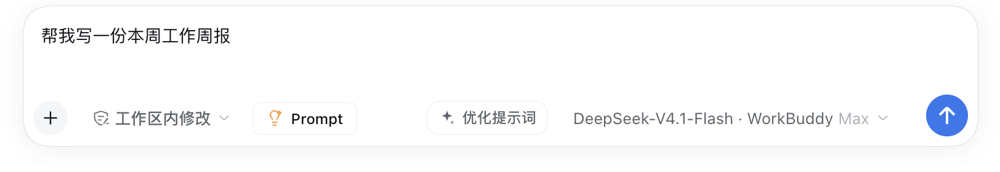

# Prompt Optimizer (dsh-composer-prompt-optimizer)

A resident **Optimize prompt** button in the DeepSeek Harness composer. It rewrites the current draft into a clearer, more specific prompt with the current conversation model, keeps the original as a snapshot, and turns into **Revert** so the change is never destructive.

The plugin is based on the `outputs/` reverse-engineering of WorkBuddy 5.7.7's "Enhance prompt" behaviour and the portable `prompt-enhancer` prompt assets, reimplemented on DeepSeek Harness slots, the `llm` service, and a local HTTP bridge.




## Features

- **Resident in the composer**: registered in `conversation.input.right`, just before the send action.
- **One-click optimization**: reads the draft and calls `ctx.llm.stream()` in a single-turn, tool-free, low-temperature request.
- **One-click revert**: keeps a `before` snapshot and restores it from the button.
- **Manual-edit protection**: if you edit the draft after optimizing, the snapshot is discarded so revert can never overwrite new input.
- **Cancellation and soft failure**: cancel an in-flight request; failures keep the original draft and show a retry state.
- **Readable failures**: a localized popover explains the cause, gives an actionable hint, and shows the error code, the model used and expandable technical details.
- **Automatic recovery**: a stale reasoning level is never forwarded after a model switch; a truncated output is retried once with a larger token budget.
- **Language preserving**: Chinese in / Chinese out, English in / English out, mixed input keeps a natural mix, and no language labels are emitted.
- **Never executes the task**: it sharpens the ask, never answers it.
- **Text-only replacement**: attachments stay in the attachment rail; only the text draft is rewritten.

## Install

### From a local directory (development)

```bash
dsh plugin --profile desktop add /absolute/path/to/dsh-composer-prompt-optimizer
```

Or use the Plugin Manager's local-bundle install action. Restart Harness once after installation.

### From npm (after publishing)

```bash
dsh plugin --profile desktop add dsh-composer-prompt-optimizer
dsh plugin --profile desktop add dsh-composer-prompt-optimizer@0.1.2
```

## Use

1. Type a draft, e.g. `write something about our Q3 results`.
2. Click **Optimize prompt** on the right of the composer.
3. After a few seconds the draft is replaced and the button becomes **Revert**.
4. Send it, or click **Revert** to restore the original.
5. If you edit after optimizing, the button returns to **Optimize prompt** and the snapshot is discarded.

| State | Label | Click |
| --- | --- | --- |
| Idle | Optimize prompt | Start |
| Loading | Cancel (spinner) | Abort and restore |
| Optimized | Revert | Restore the original draft |
| Error | Retry | Try again |

### Failures explain themselves

A failed optimization does not just say "Retry". A popover above the button shows:

- a **cause** (e.g. "Model rate limit reached", "Reasoning level incompatible", "Model unavailable", "Optimization timed out");
- an **actionable hint** (e.g. "Switch to another model in the composer, or wait for the quota to reset");
- the **error code and the model used**;
- expandable **technical details** with the raw provider error;
- **Retry / Close** actions.

Common codes: `rate_limited`, `unsupported_effort`, `unknown_model`, `unknown_provider`, `auth_failed`, `empty_result`, `output_truncated`, `timeout`, `no_model`, `unavailable`, `network`.

## Configuration

```yaml
- id: prompt-optimizer
  name: 'dsh-composer-prompt-optimizer'
  config:
    temperature: 0.3      # 0–2, lower stays closer to the original intent
    maxTokens: 2048       # 256–8192; reasoning models need a larger budget
    timeoutMs: 60000      # 1s–300s
    # reasoningEffort: high  # optional; omitted by default to stay compatible
```

**The plugin has no `provider` / `model` setting and ships no API key.** It always uses the model selected for the composer's current session, and therefore the credential you already configured in Harness for that provider. It never reads environment variables or constructs a request to a model service. Only a session without a selection falls back to the Harness default model.

The plugin never forwards a stale `reasoningEffort` from a previous model selection — that was the cause of "model does not support reasoning effort" after switching models. Only an explicit config value is sent, and a model rejection is retried once without it.

## Compatibility

- DeepSeek Harness `>= 0.2.0-rc.2`.
- Web client only (`dsh.client.platform: web`): available in the Web GUI and the desktop app; no button in pure CLI.
- Uses the standard `conversation.input.right` slot and `setDraft` input action. It does not read or modify another plugin's DOM.

## Privacy and security

- No data collection or upload.
- Network behaviour is limited to the browser calling the local Harness route `/prompt-optimizer/api/*` and the Host calling `ctx.llm.stream()` against the model service you configured.
- No file access, command execution, tool registration, or session-log writes.
- The route is served by the Harness local web server. If you bind Harness to a non-loopback address, review that deployment's access control.

## Development checks

```bash
node --check index.js
node --check client.js
node --test test/*.test.mjs
```

## License

MIT
