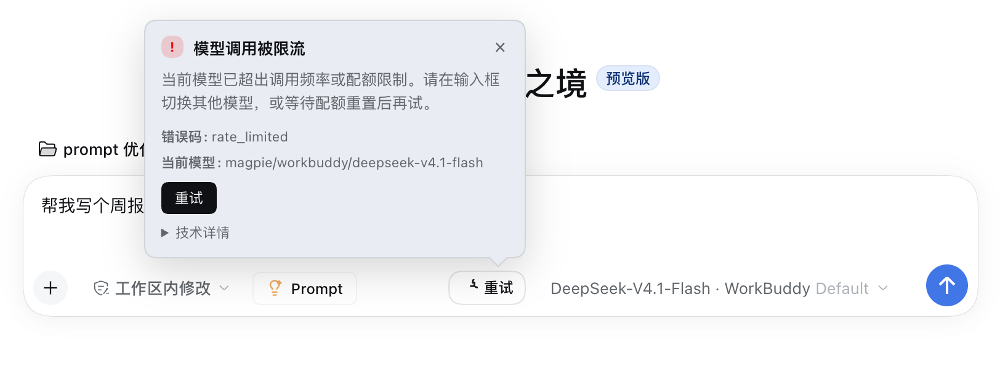

# 提示词优化 · dsh-composer-prompt-optimizer

> 常驻在 DeepSeek Harness 输入框里的「优化提示词 / 回退原文」按钮。
> 点一下，用**你当前选中的模型**把草稿改写成更清晰、可执行的提示词；改写结果可一键回退。

[English](README.md) | 中文


---

## 一、它解决什么问题

大多数「提示词不好用」不是模型的问题，而是草稿本身含糊：没说要什么格式、没给约束、没交代上下文。用户往往在发送之后才发现问题，或者又要重打一遍。

这个插件把「把话说清楚」这一步做成输入框里的一个按钮：

- 不用打开新页面、不用另开对话、不用复制粘贴到别的工具；
- 改写**只针对提示词本身**，不会替你执行任务，也不会额外消耗一轮对话；
- 结果直接写回输入框，**原文始终可回退**；
- 用的是你**已经在输入框里选好的模型**——不引入插件自己的模型，也不引入插件自己的 API Key。

---

## 二、设计思路

### 2.1 整体结构：Host 负责推理，Client 只负责交互

插件分成两半，职责严格分开：

```
┌──────────────────────── 浏览器（client.js） ─────────────────────────┐
│ conversation.input.right 插槽                                        │
│  PromptOptimizerButton                                               │
│   ├─ useInput          读草稿 / 输入阶段 / 修订号                     │
│   ├─ useProjection     读「当前会话选中的模型」provider + model       │
│   ├─ inputActions.setDraft(text)  整框替换（宿主原生写法）            │
│   └─ 状态机：idle → loading → done(before, after) / error            │
│                        │ POST /prompt-optimizer/api/enhance          │
└────────────────────────┼─────────────────────────────────────────────┘
                         ▼
┌──────────────────────── Host（index.js） ─────────────────────────────┐
│ ctx.webServer.register（prefix 路由，跟随本机地址）                    │
│  ├─ GET  /health    能力与当前模型自检                                 │
│  └─ POST /enhance   cleanInput → resolveSelection → ctx.llm.stream     │
│                     → 收集 text-delta → cleanOutput → JSON             │
│  超时 60s / 浏览器断开即 abort / 错误分类与可操作建议                    │
└────────────────────────┬─────────────────────────────────────────────┘
                         ▼
          Harness `llm` 服务 → 你为该 provider 配置的 adapter 与凭据
```

**为什么拆成两半**：浏览器里不能放密钥，也不能直接决定用哪个 provider。Host 侧调用 Harness 自己的 `ctx.llm.stream()`，凭据、重试策略、网关全部复用 Harness 已有配置。插件本身**零凭据**。

### 2.2 关键取舍（每一条都对应实际实现）

| 决策 | 选择 | 真实原因 |
| --- | --- | --- |
| 交互方式 | 直接替换 + 快照回退 | 复刻最省点击的交互；同时用 `before` 快照保证「永不破坏用户输入」 |
| 模型来源 | 输入框当前会话的 `modelSelection` | 用户看到的模型就是用的模型，凭据也随之对齐；`0.1.2` 之前的实现误用全局默认模型，已修正 |
| 推理等级 | **不传** `reasoningEffort` | 切换模型后残留 `max` 曾导致 `does not support reasoning effort`；改写是低思考任务，不需要高推理等级 |
| 输出预算 | `maxTokens` 默认 2048 | 推理模型会先用预算做隐藏推理，1024 常导致正文没写完就被截断 |
| 截断处理 | 自动翻倍预算重试一次 | 把「偶发失败」变成「自动恢复」，避免用户手动重试 |
| 插件配置 | **不允许** `provider` / `model` | 插件一旦能指定模型，就能指定到别人的模型/凭据；这属于越权 |
| 文本范围 | 只替换文本 | 附件（图片/文件）留在附件区；引用 chip 可能被展平为文本 |
| 错误呈现 | 输入框上方的提示气泡 | 只写在 `title` 里用户根本看不到；气泡给出原因、建议、错误码、模型、技术详情 |

### 2.3 状态机与「不破坏用户输入」的四道保险

| 保险 | 触发条件 | 行为 |
| --- | --- | --- |
| 草稿变更则丢弃结果 | 请求期间 `draft` 与发起时不一致 | 中止请求并回到空闲，不覆盖新输入 |
| 手动编辑即失效 | 已优化后 `draft` 与 `after` 不一致 | 丢弃快照，按钮回到「优化提示词」 |
| 取消 | 请求中点「取消优化」 | abort fetch，原文不变 |
| 失败不阻塞 | 超时 / 模型错误 / 服务不可用 | 保留原文，显示可重试状态与错误气泡 |

### 2.4 提示词是怎么设计的

提示词存放在 [prompts/system-prompt.txt](prompts/system-prompt.txt)（约 4.5 KB，76 行），来源于 WorkBuddy「增强提示词」的逆向分析，并针对「过度扩写」做过一轮修补。它不是一句「帮我优化一下」，而是由六层约束组成：

**① 单一角色与单一输出**
> You are a Prompt Enhancement Agent. Your only job is to rewrite a draft prompt... You never carry out the request itself.

把「改写」和「执行」切干净，避免模型开始回答问题。

**② 语言一致性是最高优先级**

中文进中文出、英文进英文出、其他语言保持原语言、混排保持自然混排，并且**禁止在输出里解释语言**（不出现 `User input is in Chinese` 这类元信息）。这是硬约束，写在 `LANGUAGE` 段。

**③ 明确的改写动作清单**

不是「让它更好」，而是要求模型逐项检查：

- 把任务和范围写准；
- 补上目标助手需要的上下文；
- 把参数和约束写显式；
- 需要时规定输出格式；
- 只在能消除歧义时才加示例；
- 语气与复杂度匹配场景；
- 删冗余；
- **保留原目标、主题、约束、输出类型**。

**④ 硬性禁止项（最关键的一层）**

`HARD RULES` 与 `WHAT NOT TO ADD` 直接列出最常见的「越改越糟」：

- 只输出改写后的提示词，不要前言、标题、解释、代码围栏；
- **不回答问题**——「怎么修这个 bug」只能变成「更精确地请求修 bug」，绝不能变成修复方案；
- **不发明范围**——不加用户没提过的技术、工具、事实、要求、章节；
- 不插入澄清步骤、确认请求、额外交付物；
- 不出现语言标签；
- 必须至少改进一处，但改进可以是「更锋利、范围更准」，不一定是「更长」；
- 不得以未完成列表、悬空连词、冒号结尾。

**⑤ 输出卫生**

纯文本返回，不要包裹引号、不要代码围栏。Host 侧还会二次清洗：去零宽字符/BOM → trim → 去掉成对包裹引号 → 去掉包裹代码围栏；清洗后为空即判定为失败（`empty_result`），而不是把空串写回输入框。

**⑥ 用示例做「少样本校准」**

提示词内给了 7 组示例（中/英/混排），其中「做一个网站」的示例只改到「说明目标用户、核心页面、主要功能、页面结构、交互流程、视觉风格」，**不会**自动扩成一份项目说明书。这直接约束了扩写的边界感。

> 为什么不把用户消息也套一层模板？因为模板里的语言规则和示例会和 system prompt 重复，模型会倾向于「多写」而不是「写准」。现在用户消息就是草稿本身，system prompt 承担全部约束。

### 2.5 错误体系：让失败可解释

Host 侧 `classifyFailure()` 会把 provider 返回的自由文本错误映射为稳定错误码，每个码都带可操作建议：

| 错误码 | 含义 | 建议 | HTTP |
| --- | --- | --- | --- |
| `rate_limited` | 模型频率/配额限制 | 切换模型或等待配额重置 | 429 |
| `unsupported_effort` | 模型不支持该推理等级 | 自动去掉等级重试一次 | 503 |
| `unknown_model` | 模型未配置 | 切换可用模型 | 503 |
| `unknown_provider` | 模型服务未注册 | 检查模型设置 | 503 |
| `auth_failed` | 鉴权失败 | 检查 API Key / 登录态 | 401 |
| `empty_result` | 模型只输出推理或空内容 | 切换模型 | 502 |
| `output_truncated` | 输出被长度上限截断 | 自动翻倍预算重试；仍失败则缩短草稿 | 502 |
| `timeout` | 请求超时 | 重试 / 缩短草稿 / 换更快的模型 | 408 |
| `no_model` | 未选择模型 | 先在输入框选择模型 | 503 |
| `unavailable` / `network` | 服务不可用 | 确认插件启用、刷新页面 | 503 |
| `empty_input` / `input_too_long` | 空草稿 / 超长（>30000 字符） | 补内容 / 缩短 | 400 |

---

## 三、实际使用效果

以下全部是插件在本机运行时的**真实输出**（模型：`workbuddy/deepseek-v4.1-flash`，温度 0.3，单轮无工具）。

### 3.1 中文短草稿

| | 内容 |
| --- | --- |
| 输入 | `做个网站` |
| 输出 | `请设计并实现一个网站，先说明目标用户和核心用途，再列出主要页面与功能模块，并给出页面结构、交互流程和视觉风格要求。` |
| 耗时 | 约 1.9 秒 |

### 3.2 中文中长草稿

| | 内容 |
| --- | --- |
| 输入 | `帮我写个周报` |
| 输出 | `帮我撰写一份本周工作周报，按以下三部分组织：本周完成的工作、遇到的问题、下周计划。每部分用条目式表述，语言简洁，突出结果和关键数据。` |
| 耗时 | 约 2.0 秒 |

### 3.3 英文草稿（语言保持一致）

| | 内容 |
| --- | --- |
| 输入 | `Please explain what this code does` |
| 输出 | `Explain what this code does, covering its main purpose, key control flow, and any important edge cases or potential issues.` |
| 耗时 | 约 1.3 秒 |

### 3.4 中英混排（保持自然混排，不强行翻译成单一语言）

| | 内容 |
| --- | --- |
| 输入 | `这段代码有 bug，can you help me fix it?` |
| 输出 | `请分析这段代码中的 bug，说明问题的根本原因，并给出最小范围的修复方案及必要的验证步骤。` |
| 耗时 | 约 1.6 秒 |

### 3.5 效果特征（可直接对照验证）

1. **短草稿只变准，不变长**：`做个网站` 从 4 个字变成一句结构化要求，不是一份项目说明书。
2. **不回答问题**：输入是「怎么修 bug」，输出仍是「请求修 bug」，没有给出代码。
3. **不发明技术栈**：输入没提框架，输出也不会擅自加上 Next.js、Vue 之类。
4. **语言锁定**：英文进英文出；混排进、混排出，不会突然全变中文。
5. **可回退**：写入后按钮变为「回退原文」，点击恢复原文，逐字节一致。
6. **手动编辑即失效**：优化后再改一个字，按钮回到「优化提示词」，不会误覆盖你的新输入。

### 3.6 失败时的真实表现

当某个模型触发限流时，输入框上方会弹出（实测文案）：

> **! 模型调用被限流**
> 当前模型已超出调用频率或配额限制。请在输入框切换其他模型，或等待配额重置后再试。
> 错误码：`rate_limited` ｜ 当前模型：`magpie/workbuddy/deepseek-v4.1-flash`
> ［重试］ ▸ 技术详情



气泡不会遮挡输入框，点击别处或按 Esc 会自动关闭，草稿始终可编辑。

---

## 四、安装

### 4.1 从 npm 安装（推荐）

```bash
# 装进你实际使用的 DSH 入口对应的 profile
dsh plugin --profile desktop add dsh-composer-prompt-optimizer
# 桌面端用 desktop；自启 Web 服务用 web
dsh plugin --profile web     add dsh-composer-prompt-optimizer

# 锁定版本
dsh plugin --profile desktop add dsh-composer-prompt-optimizer@0.2.0
```

安装后**重启一次** Harness。输入框右侧出现「优化提示词」即安装成功。

### 4.2 从本地目录安装（开发调试）

```bash
dsh plugin --profile desktop add /绝对路径/dsh-composer-prompt-optimizer
```

也可以把本目录放成 profile 的 `link:` 依赖，或在 Harness 插件管理器里安装本地 bundle。

### 4.3 从 GitHub Release 的 tarball 安装

```bash
dsh plugin --profile desktop add https://github.com/keshaoqin/dsh-composer-prompt-optimizer/releases/download/v0.2.0/dsh-composer-prompt-optimizer-0.2.0.tgz
```

### 4.4 卸载

```bash
dsh plugin --profile desktop remove dsh-composer-prompt-optimizer
```

---

## 五、使用方法

### 5.1 基本流程

1. 在输入框写下草稿，例如 `帮我写个周报`；
2. 点击输入框右侧的「优化提示词」；
3. 几秒内草稿被替换为优化后的版本，按钮变为「回退原文」；
4. 直接发送，或点「回退原文」恢复；
5. 优化后若你手动修改草稿，按钮自动回到「优化提示词」，快照失效。

### 5.2 按钮状态

| 状态 | 显示 | 点击行为 |
| --- | --- | --- |
| 空闲 | 优化提示词 ✦ | 开始优化 |
| 请求中 | 取消优化（转圈） | 中止请求，原文不变 |
| 已优化 | 回退原文 ↺ | 恢复优化前的草稿 |
| 失败 | 重试 ↻ | 重新优化；同时弹出错误气泡 |

窄屏（输入行宽度 < 560px）时按钮只显示图标，仍可点击。

### 5.3 与其他输入内容的关系

- **附件**：图片/文件不受影响，仍留在附件区；
- **引用 chip**：优化会按纯文本整框替换，引用 chip 可能被展平为文本（这是已知限制）；
- **发送中状态**：输入框正在发送/锁定时按钮禁用。

### 5.4 快捷自检

```bash
curl -s http://127.0.0.1:<端口>/prompt-optimizer/api/health
# {"ok":true,"plugin":"dsh-composer-prompt-optimizer","version":"0.2.0","llm":true,"model":{...}}
```

`llm:true` 表示 Harness LLM 服务可用；`model` 是当前解析到的模型。

---

## 六、配置

在插件条目的 `config` 中可调（默认值如下）：

```yaml
- id: prompt-optimizer
  name: 'dsh-composer-prompt-optimizer'
  config:
    temperature: 0.3      # 0–2，低温度更贴近原意
    maxTokens: 2048       # 256–8192，推理模型需要更多输出预算
    timeoutMs: 60000      # 1000–300000
    # reasoningEffort: high   # 可选；默认不传，避免与模型不兼容
    # systemPrompt: '...'     # 可选；覆盖内置提示词（调试用）
```

**插件不提供 `provider` / `model` 配置项**：优化始终使用你在输入框当前会话选择的模型，因此也始终使用你为该 provider 配置的凭据。仅当会话没有模型选择时，才回退到 Harness 默认模型。

---

## 七、兼容性

- 需要 DeepSeek Harness `>= 0.2.0-rc.2`；
- 仅注册 Web 客户端（`dsh.client.platform: web`），Web GUI 与桌面端可用，纯 CLI 无按钮；
- 依赖 Harness 标准插槽 `conversation.input.right` 与标准输入动作 `setDraft`；
- 不读取、不修改其他插件的 DOM。

---

## 八、隐私与安全

- **不收集、不上传任何数据**；
- **插件零凭据**：不含 API Key，不读环境变量，不直接请求任何模型服务；
- 网络行为只有两条：
  1. 浏览器 → 本机 Harness 路由 `/prompt-optimizer/api/*`；
  2. Host → Harness 内部 `ctx.llm.stream()`（由你配置的 adapter 发请求）；
- 不读文件、不执行命令、不注册模型工具、不写会话日志；
- 路由只由 Harness 本地 Web 服务承载；若你把 Harness 绑定到非回环地址，请自行评估该部署的访问控制。

> 提示：本插件会把草稿发给**你自己配置的模型服务**做改写。如果你的草稿含敏感信息，请按你对该模型服务的信任程度决定是否使用。

---

## 九、目录结构

```
dsh-composer-prompt-optimizer/
  package.json                 # dsh.bundle + dsh.client 声明
  cordis.patch.yml             # 插入 Host 行与默认 config
  index.js                     # Host：路由、模型解析、调用、错误分类
  client.js                    # 浏览器：按钮、状态机、错误气泡
  prompts/system-prompt.txt    # 改写提示词（六层约束）
  locale/{zh,en}.json          # 插件市场标题/描述
  icon.svg                     # 原创图标
  docs/
    DESIGN.md                  # 需求分析与架构设计
    MARKETPLACE.md             # 两处发布的完整步骤
    screenshot-*.png           # 真实运行截图
  test/
    prompt.test.mjs            # 输入/输出清洗、配置、错误分类
    host.test.mjs              # Host 端到端（伪造 llm 流）
```

---

## 十、开发与自检

```bash
node --check index.js
node --check client.js
node --test test/*.test.mjs     # 16 项全部通过
npm pack --dry-run              # 检查打包清单
```

---

## 十一、发布（npm 与插件市场）

发布分两步，完整步骤与所需配置见 [docs/MARKETPLACE.md](docs/MARKETPLACE.md) 和 [PUBLISHING.md](PUBLISHING.md)。摘要：

**① npm**

```bash
npm pack --dry-run
npm publish --access public     # package.json 已设 publishConfig.access = public
```

账号启用 2FA 时，需要 **Bypass 2FA + Read and write**（不是 stage only）的 Granular Access Token；token 只存本机，不要写进仓库。

**② 插件市场（awesome-dsh-plugin）**

- 仓库：https://github.com/LingHXiao/awesome-dsh-plugin
- 只需新增一个文件：`data/plugins/keshaoqin__dsh-composer-prompt-optimizer.yml`
- 内容（已准备：[docs/marketplace-entry.yml](docs/marketplace-entry.yml)）：

```yaml
url: https://github.com/keshaoqin/dsh-composer-prompt-optimizer
name: keshaoqin/dsh-composer-prompt-optimizer
category: ui
tarball: https://github.com/keshaoqin/dsh-composer-prompt-optimizer/releases/download/v0.2.0/dsh-composer-prompt-optimizer-0.2.0.tgz
description:
  en: 'A resident Optimize / Revert button in the DSH composer: one click rewrites the draft with the model selected in that composer, keeps the original restorable, and explains any failure with a cause, an error code and how to recover.'
  zh: 'DSH 输入框常驻「优化提示词 / 回退原文」按钮：用输入框当前选中的模型就地改写草稿，原文随时可回退，失败时说明原因、错误码与处理办法。'
```

- 硬性门槛：仓库需创建满 1 天（本仓库创建于 2026-11-11），已满足；
- 需要仓库声明 `dsh.bundle`、发布到 npm 或提供 tarball、添加 `dsh-plugin` topic —— 均已具备；
- 提交 PR（一个 PR 最多 3 条，这里 1 条），维护者审核后 README 自动生成。

---

## 十二、已知限制

- 仅 Web 客户端；纯 CLI 不显示按钮；
- 以纯文本整框替换草稿，引用 chip 可能被展平为文本（附件不受影响）；
- 依赖 Harness 的 LLM 服务与模型选择；模型限流时需切换模型；
- 改写质量取决于所选模型；推理等级默认不传，以减少兼容问题。

---

## License

MIT · 作者 muxiaoke
